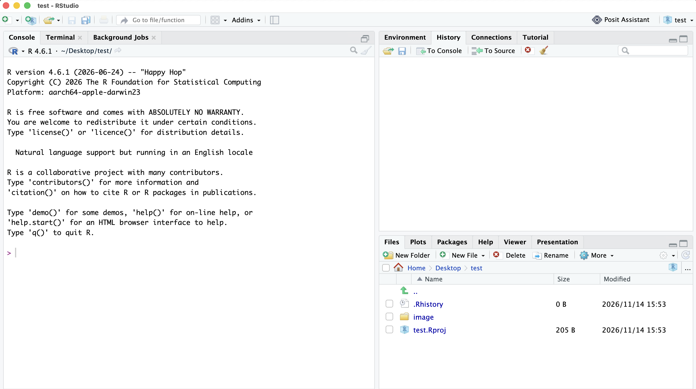
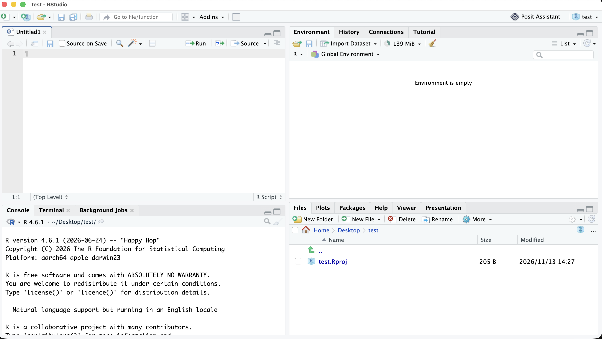
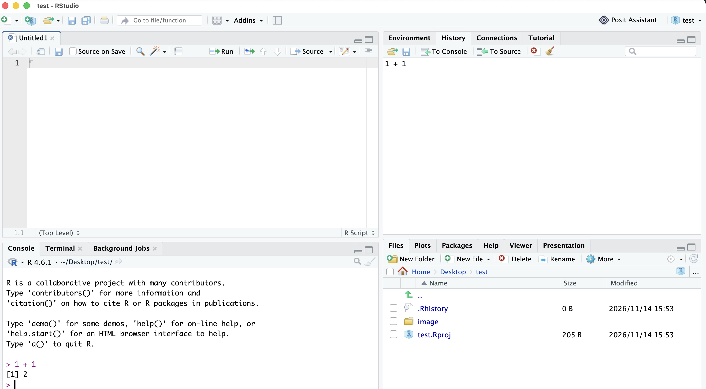

# 計量経済学Basics

川田恵介 「計量経済学Basics」(ライブラリ経済学Basics & Frontier 11, 新世社) のサポートページです。
Rによる実習について, 環境設定をサポートし, コード例を提供します。

## Rの設定

1. **Comprehensive R Archive Network** より、自身のPCのOS (Windows/Mac/Linux) に適合した, **R** (統計的な計算を行うための無料アプリ) をダウンロードしてください (URLは以下です)。 **Rを必ず最初にインストールしてください**。

    - https://cran.r-project.org/

        - **Windowsの場合**: 「Download R for Windows」をクリック後、「install R for the first time」をクリックしてダウンロードしてください。

        - **Macの場合**: 「Download R for macOS」をクリック後、ご自身のMacのチップ（Apple SiliconかIntelか）に適合したファイルをダウンロードしてください。

    - ダウンロード終了後は、ファイルを開き, 画面表示に従ってインストールを行なってください。

2. Rは単体でも利用できますが, 統合開発環境 (コードの補完など, Rによるコーディングを補助するアプリ) を用いることで、快適に分析を進めることができます。本書では十分な実績のあるアプリである、Rstudioを利用を推奨します^[他の選択肢としては, vs-code, positron, zed などがあります。]。開発元であるPosit社のページから,  ダウンロードをしてください (URLは以下です)。

    - https://posit.co/download/rstudio-desktop/

        - 画面をスクロールした一番最後にある「Download RStudio」をクリックしてください。

        - 移動したページで「Download for "あなたのPCのOS名"」ボタンをクリックしてください。

    - ダウンロード終了後は、ファイルを開き, 画面表示に従ってインストールを行なってください。

3. 上記の作業を終えると, Rstudioというアプリを起動できます。

# Rstudioの画面

Rstudioを起動すると, 以下の画面が表示されます;



「ctr + shit + N」を同時に押して、新しい(スクリプト)ファイルを開いてください^[Rstudioでは, スクリプトファイル以外にも, Quarto Documentファイルなど, 他の選択肢もあります。]。



以上の画面は大きく４分割されており、それぞれの画面に以下の役割があります。

| 名称 | 位置(初期設定) | 役割 |
|---|---|---|
| ソース | 左上 | スクリプトを書く |
| コンソール | 左下 | コードを実行し結果を見る |
| 環境 | 右上 | 作成した変数やデータを確認する |
| ファイル/プロット | 右下 | ファイル一覧、グラフ、ヘルプの表示 |

まずはコンソール (左下) に, 1+1と打ち込んで, Enterを押してください。

````r
1 + 1
````

以下が表示されるはずです;

````text
2
````



# Project folderの設定

Rで何らかのデータ分析プロジェクトを行う際には、プロジェクト専用のフォルダー (Project folder) を作成することをおすすめします。
Rstudioではproject folderを以下の画面にあるNew Projectをクリックし, 以下の手順で作成できます:

1. New Directoryをクリック

2. New Projectをクリック

3. 以下の画面のDirectory nameにフォルダーの名前 (スペースなどを含めない英語のみの名前を推奨します)を入力し, Create Projectをクリック

# 保存

全てフォルダーに保存される
データも保存できる

# Packageの整備

Rをインストールした後は, packageと呼ばれる追加プログラムをインストールすることを推奨します。
packageのインストールには複数の方法がありますが、ここではpak packageを活用する方法を推奨します。

1. Rに同梱されているinstall.package関数を用いて, pak package (packageをインストールするためのpackage)をインストールします。コンソール (左下) に以下を打ち込んで, Enterを押してください。

````r
install.package("pak")
````

2. pak packageに収録されているpak関数を用いて, tidyverseをインストールします。コンソール (左下) に以下を打ち込んで, Enterを押してください。

````r
pak::pak("tidyverse")
````


3. 実習用データが収録されている。コンソール (左下) に以下を打ち込んで, Enterを押してください。

````r
pak::pak("tetokawata/data4kawata")
````

4. 以上をインストールすれば, 最初の実習を行うことができます。学習を行う中で、適宜以下のパッケージをインストールしてください:

````r
pak::pak("estimatr")
pak::pak("cobalt")
pak::pak("hdm")
pak::pak("fixest")
pak::pak("sensemakr")
pak::pak("Car")
````

## データの保存

apartmentデータの保存と読み込み

コピペすれば良い